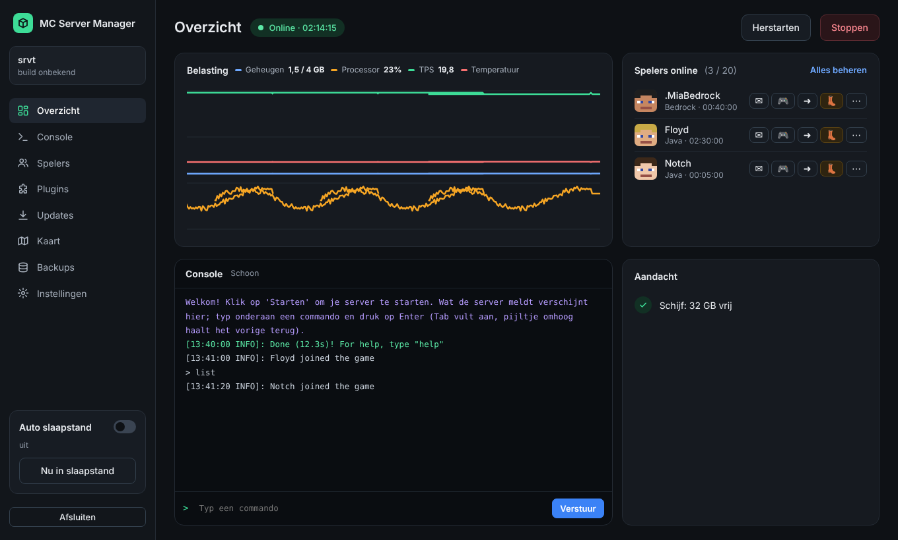
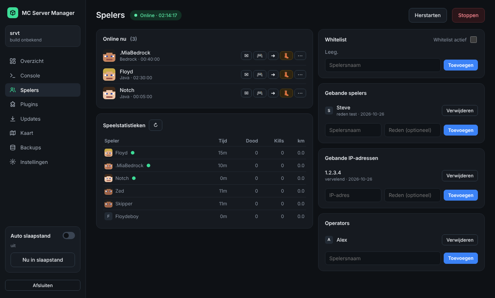
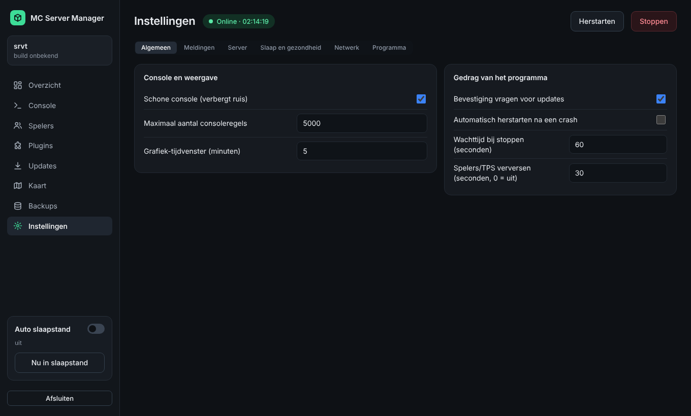

# ⛏ MC Server Manager

**Eén venster om je eigen Minecraft-server (Paper) te beheren.**
Starten, console, plugins, updates, kaart, backups en een webapp voor je telefoon, zonder losse programma's of commando's.

Schermafbeeldingen met voorbeeldgegevens.

---

## Inhoud
[Functies](#functies) · [Installeren](#installeren) · [Eerste keer](#eerste-keer-gebruiken) · [Tab-aanvulling](#tab-aanvulling-in-de-console) · [Telefoon](#webapp-voor-je-telefoon) · [Bijwerken](#het-programma-bijwerken) · [Veelgestelde vragen](#veelgestelde-vragen) · [Privacy](#privacy-en-netwerk) · [Versies](#versies)

## Functies

Het programma opent in een eigen venster met links het menu. Het is alleen bereikbaar vanaf deze computer; de bron
staat in [`nieuwe_interface/`](nieuwe_interface/) en wordt met `inbouwen.py` in het ene programmabestand gezet.

| Onderdeel | Wat je er doet |
|---|---|
| **Overzicht** | Live belasting (geheugen, processor, TPS en temperatuur; de grafieken blijven bewaard na een herstart), spelers online met snelle acties per speler (bericht sturen, spelmodus, teleporteren, kicken), de console en een *Aandacht*-kaart. Daar staat of er een update of backup is, hoeveel schijfruimte vrij is en of het opstarten goed ging. |
| **Console** | Schone modus (verbergt ruis; dubbelklik op een regel om zulke regels te verbergen, of pas de lijst aan onder Instellingen → Algemeen), zoeken in het logboek, Tab-aanvulling en commandogeschiedenis. Wat je zelf typt, blijft altijd zichtbaar. |
| **Spelers** | Wie online is, speelstatistieken (tijd, doden, kills, afstand), whitelist, bans, IP-bans en operators, ook van Bedrock-spelers. |
| **Plugins** | Aan- en uitzetten, verwijderen, zoeken op naam *of op beschrijving* en installeren, inclusief afhankelijkheden. Per plugin zie je of hij up-to-date is. |
| **Updates** | Paper (`server.jar`) en plugins controleren en bijwerken via Modrinth, Hangar, GitHub en GeyserMC, en het programma zelf. Vóór elke update komt er een backup. Na een programma-update kan de server vanzelf weer starten; staat er iemand online, dan wacht het programma tot de server leeg is. |
| **Kaart** | Live kaart van je wereld (via [squaremap](https://github.com/jpenilla/squaremap)) met spelers en soepel zoomen; als de server uit staat zie je de opgeslagen kaart. Teken een gebied om het met Chunky vooraf te genereren (te annuleren); dat pauzeert zelf zodra er een speler binnenkomt. |
| **Backups** | Beheert de plugin [Backuper](https://github.com/DVDishka/Backuper): backups bekijken en verwijderen, instellingen aanpassen en de backups die dit programma zelf maakt. |
| **Instellingen** | Ingedeeld in Algemeen, Meldingen, Server, Slaap en gezondheid, Netwerk en Programma. Windows-meldingen en berichten op je telefoon staan duidelijk gescheiden. |

Daarnaast:

- **Voortgangsbalken** bij opstarten én stoppen. Het programma onthoudt hoe lang jouw server nodig heeft en schat daarmee. Stopt de server terwijl hij nog opstart, dan wacht het tot dat klaar is.
- **Opstartcontrole:** na het opstarten leest het programma het logboek door en meldt een plugin die niet laadt, een bezette poort, te weinig geheugen, een EULA die nog niet is geaccepteerd of plugins die geen updates kunnen opzoeken.
- **Auto slaapstand:** de server stopt veilig als er een tijd niemand online is en start vanzelf als er iemand probeert te joinen.
- **Netwerkcontrole** (Instellingen → Netwerk): of vrienden via internet kunnen verbinden, voor Java en Bedrock.
- **Meldingen** bij crash, start, spelers en klaar met genereren, in Windows en optioneel op je telefoon.
- Alles in het Nederlands.

  
  

## Installeren

1. Installeer [Python 3.8 of nieuwer](https://www.python.org/downloads/) en vink **"Add Python to PATH"** aan.
2. Download [`mc_server_manager.py`](mc_server_manager.py) en zet het in een eigen map.
3. Dubbelklik op het bestand (of `python mc_server_manager.py`).
4. Kies bovenaan je server-map. Klaar.

De instellingen staan naast het programma in `mc_server_manager_config.json`.

**Optioneel** (het programma vraagt er zelf naar wanneer ze nuttig zijn):

| Pakket | Waarvoor | Installeren |
|---|---|---|
| `psutil` | CPU en geheugen in de grafieken | `pip install psutil` |
| `pillow` | Vloeiend zoomen op de kaart | `pip install pillow` |

Liever een `.exe`? `pip install pyinstaller` en dan
`pyinstaller --onefile --windowed --name MCServerManager mc_server_manager.py`.
Een `.exe` kan zichzelf niet bijwerken.

## Eerste keer gebruiken

1. **Server-map kiezen** (linksboven in het menu). Het programma herkent Paper, de Minecraft-versie en je plugins.
2. **Server starten** met de groene knop. De console toont wat de server meldt.
3. **Plugins en updates:** klik op *Alles controleren* bij Updates. Dat kost niets, er wordt pas iets veranderd als jij dat vraagt.
4. Onder **Instellingen → Netwerk** kun je testen of vrienden kunnen verbinden.

Staat er een knop of instelling die je niet snapt? Bij veel opties onder Instellingen staat een korte uitleg.

## Tab-aanvulling in de console

Net als in de echte serverconsole: typ een deel van een commando en druk op **Tab**; **↑/↓** haalt eerdere
commando's terug. Zonder extra hulp leert het programma de commando's uit `/help`. Voor *exact* dezelfde
aanvullingen als de server (alle subcommando's en argumenten van plugins) plaatst het programma bij het eerste
starten het kleine hulpplugin **MCMTab** in `plugins/`. Herstart de server daarna één keer.

De broncode en uitleg staan in [`hulpplugin/`](hulpplugin/). Het plugin doet niets anders dan op verzoek van de
console de aanvullingen doorgeven.

## Webapp voor je telefoon

Zet bij **Instellingen → Netwerk → Telefoon-app** de toegang aan en kies een wachtwoord. Open daarna het getoonde adres op je telefoon
(zelfde wifi) en voeg het toe aan je beginscherm. Je ziet en bedient dezelfde dingen als op de computer:
server, plugins, updates, kaart, backups en beheer. De app is standaard alleen bereikbaar vanaf je eigen netwerk.

### Berichten op je telefoon (ntfy)

Wil je een bericht als er iemand online komt, de server crasht of er iets mis lijkt bij het opstarten? Zet dat aan onder
**Instellingen → Meldingen → Telefoon**. Het programma gebruikt daarvoor [ntfy](https://ntfy.sh): installeer de app op
je telefoon, kies *Nieuw kanaal maken* in het programma en abonneer je in de app op dat kanaal. De berichten gaan
via internet (standaard `ntfy.sh`, je kunt ook je eigen ntfy-server invullen). Wie je kanaalnaam kent, kan meelezen;
laat de naam dus willekeurig.

## Het programma bijwerken

Open Instellingen → **Programma** en vul `https://github.com/smikkelvriend/mc-server-manager` in.
Het programma controleert bij het opstarten en daarna elke 6 uur. Is er een nieuwe versie, dan verschijnt
**⬆ Update** met wat er nieuw is. Veilige updates worden direct toegepast; de rest vraagt om een herstart.
De vorige versie wordt bewaard in `programma_backups`.

Alleen `mc_server_manager.py` in de hoofdmap telt mee en wordt eerst gecontroleerd op geldige Python en een hoger
versienummer. Gebruik alleen een repository die je vertrouwt: wie die beheert, bepaalt welke code er draait.

## Veelgestelde vragen

<b>De kaart zegt "Squaremap niet bereikbaar"</b>

Het programma kan de webserver van squaremap niet bereiken. Controleer dat de plugin draait en dat het adres onder
het tabblad Kaart klopt (standaard `http://localhost:8080`). Zolang de server uit staat toont het programma de
laatst opgeslagen kaart.

<b>CPU en geheugen blijven leeg</b>

Installeer `psutil` (`pip install psutil`) en start het programma opnieuw.

<b>Wat doet het programma met mijn server-map?</b>

Het leest je configuratie en logs, en schrijft alleen als jij iets doet (starten, een plugin installeren of
verwijderen, een update). Bij updates wordt eerst een backup gemaakt en verwijderde plugins worden eerst verplaatst.

<b>De temperatuur klopt niet</b>

Zonder extra software leest het programma de thermal zone van Windows. Niet elke laptop levert die, en het is niet
altijd de CPU-temperatuur. Voor de echte waarde: laat
[LibreHardwareMonitor](https://github.com/LibreHardwareMonitor/LibreHardwareMonitor) als beheerder openstaan.

## Privacy en netwerk

Het programma praat alleen met de diensten die bij een functie horen en stuurt niets door naar de maker.

| Functie | Dienst |
|---|---|
| Updates zoeken | Modrinth, Hangar, GitHub, GeyserMC, PaperMC |
| Netwerkcontrole van buitenaf | mcstatus.io, mcsrvstat.us, minetools.eu; `api.ipify.org` voor "Mijn IP opzoeken" |
| Spelershoofdjes | mc-heads.net; Bedrock-spelers via api.geysermc.org en textures.minecraft.net |
| Programma-update | je eigen GitHub-repository |
| Berichten op je telefoon (alleen als je dat aanzet) | ntfy.sh, of je eigen ntfy-server |

Die diensten bewaren soms een oud resultaat; één dienst die "online" meldt is genoeg.

## Versies

Zie [CHANGELOG.md](CHANGELOG.md) voor wat er per versie nieuw is. Oude versies staan in
[`oude_versies/`](oude_versies/).

## Meewerken

Een bug gevonden of een idee? Open een [issue](../../issues). Vermeld je versie (staat in de titelbalk) en wat je
deed vlak voor het misging.
